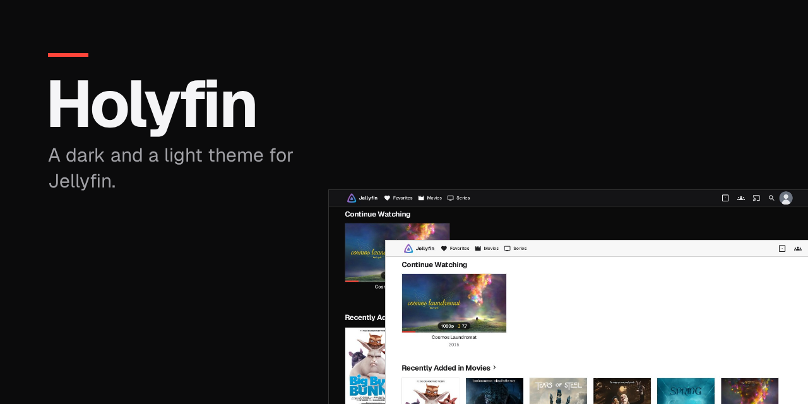
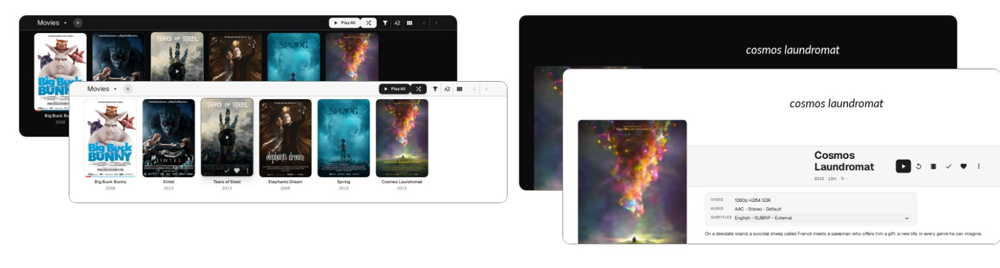
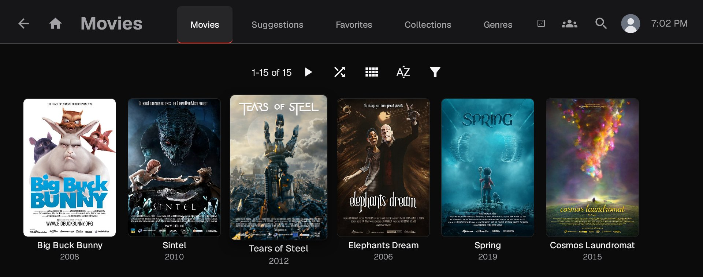

# Holyfin

[](https://github.com/roffaboy/holyfin/actions/workflows/check.yml) [](https://github.com/roffaboy/holyfin/releases/latest) [](https://github.com/roffaboy/holyfin/commits/main) [](renovate.json) [](LICENSE)



A calm theme for [Jellyfin](https://jellyfin.org), dark and light. Dark is near-black greys, light is
white with soft greys; both have one red accent, the rounded corners and shadows of HolyArrs
and [Geist](https://github.com/vercel/geist-font), after the look of
[HolyArrs](https://github.com/HolyArrs/HolyArrs). Which one shows follows Jellyfin's own Theme
setting.

It is one stylesheet, written from scratch: no other theme sits under it. Nothing is installed on
the server, and it works in the web client and in the apps built on it.

> Holyfin is unofficial. It is not made by, or affiliated with, HolyArrs. It borrows ideas and
> colour values from how HolyArrs looks, no code.



## What you get

- **One accent.** Jellyfin's blue is gone from the app: focus, links, switches, sliders, loading
  circles. It is the same red throughout.
- **Posters that react.** Hovering a poster lifts it 3 px, with a deeper shadow and a fine edge (light in
  the dark look, dark in the light one). Watched titles get a green tick, counts are red, progress is red.
- **A little red in the headings.** A small red bar before the title of each row, and the title turns red
  when you hover it.
- **A film page with room.** A taller band for the title and buttons, the logo above it, the video
  and audio details in a quiet panel with small capitals as labels.
- **Glass where things open.** The top bar, menus and drop-down lists are blurred glass with a fine
  line, and the chosen item is a soft grey step with a red tick.
- **Geist, delivered with the theme.** Nothing is loaded from Google.
- **Calm motion** in one set of durations and curves, and none at all for anyone who asked their
  system for less motion.
- **The shape of HolyArrs.** Rounded corners in the same sizes (6, 10, 12, 16 and 20 px) and its shadows;
  set a radius to 0 in the tokens if you want it square.
- **Made for a TV as well.** On a TV (the LG, Samsung and other Jellyfin apps) the text is TV-sized,
  the focused poster grows 5% with a shadow and no border, the focused tab is a lighter pill with a red
  line, and the top bar has no blur, which a TV's chip finds costly. Only tested in a browser that
  poses as a TV and on one LG; an older TV browser may draw some of it differently.

  
- **A light look too.** It follows Jellyfin's own setting: pick **Light** under Settings, Display,
  Theme and Holyfin turns light (the light palette of HolyArrs); pick **Dark** and it is dark.
  Every other Jellyfin theme shows the dark look. Each person chooses for themselves, and Jellyfin
  keeps that choice per browser or device, so pick it once on each.
- **Not the admin pages.** Jellyfin does not load custom CSS on the Dashboard (the admin pages),
  as of 12.4, so those keep Jellyfin's own look, with its own Light or Dark under Settings, Display.

## Install

In Jellyfin, open **Dashboard, General, Custom CSS** and add:

```css
@import url("https://cdn.jsdelivr.net/gh/roffaboy/holyfin@v1.2.0/theme.css");
```

Name a version (`@v1.2.0`), not `@main`. A version never changes under you, and the CDN keeps it.
The newest one is on the [Releases page](https://github.com/roffaboy/holyfin/releases/latest), with
what changed. Reload Jellyfin with Ctrl+Shift+R after you change it. A TV app keeps the old file
until the address is new, so a new version number (not a branch) is what makes it fetch the change;
restart the app after.

With a tool that sets Jellyfin's branding for you (for example Ansible), put that one line in the
Custom CSS setting.

To take it away again, empty the Custom CSS box.

### Pair it with the Jellyfin Enhanced plugin (optional)

[Jellyfin Enhanced](https://github.com/n00bcodr/Jellyfin-Enhanced) can put quality and rating tags on
every poster. In its settings, the **summary** layout shows one quiet pill ("1080p · 7.4") instead of
tags in all four corners, which suits the theme.

## Change it

Everything below the first section of `theme.css` reads from the tokens at the top. The dark set is
`:root`; the light set, the same names with other colours, is `:root[data-theme="light"]` right below it.

| Token | What it is | Default |
| ----- | ---------- | ------- |
| `--bg`, `--surface`, `--surface-2`, `--surface-3` | page and panel greys | `#0b0b0c` to `#2a2a2e` |
| `--accent`, `--accent-fill` | the red, for text and icons, and for fills | `#ff453a`, `#d42d24` |
| `--text`, `--muted`, `--faint` | text colours | `#f5f5f7`, `#a1a1a6`, `#7c7c80` |
| `--r-sm`, `--r-btn`, `--r-card`, `--r-panel`, `--r-modal` | corner radii: small things, buttons and fields, posters, menus and panels, dialogs | 6, 10, 12, 16, 20 px |
| `--lift` | how far a poster rises on hover | `-3px` |
| `--font` | the typeface | Geist |
| `--dur-fast`, `--dur`, `--dur-slow` | how long motion takes | 150, 240, 360 ms |

To make your own version, copy `theme.css` (and the `fonts/` folder, or point `--font` at another
face), change the tokens and import your copy.

## Works with

| Holyfin | Jellyfin |
| ------- | -------- |
| 1.2.x   | 12.4     |
| 1.1.x   | 12.4     |

Holyfin is made and tested on **Jellyfin 12.4**. Older versions are not tested. Jellyfin's styles
are built from class names that can change between versions, so every week the theme is checked
against the newest Jellyfin release. When something has changed, a new version of Holyfin follows
and this table is updated.

**Browsers.** The styled drop-down lists need Chrome or Edge 135 or newer. Elsewhere the browser's
own list is shown, which is fully usable. Everything else works in current Chrome, Edge, Firefox and
Safari.

**Something looks off?** [Open an issue](https://github.com/roffaboy/holyfin/issues) with your
Jellyfin version (Dashboard shows it) and, if you can, a screenshot. A page that still shows blue
is the most useful thing to report.

## Contributing

Issues and pull requests are welcome. See [CONTRIBUTING.md](CONTRIBUTING.md). The look follows
HolyArrs, with its radii and shadows.

## Credits

- Look: [HolyArrs](https://github.com/HolyArrs/HolyArrs) (colours and ideas, no code).
- Screenshots: posters of the open movies of the [Blender Foundation](https://studio.blender.org/films/), under CC BY.
- Font: [Geist](https://github.com/vercel/geist-font) by Vercel, under the SIL Open Font License. It is
  delivered with the theme in `fonts/` (with its licence, `fonts/OFL.txt`).

## Licence

[MIT](LICENSE).
